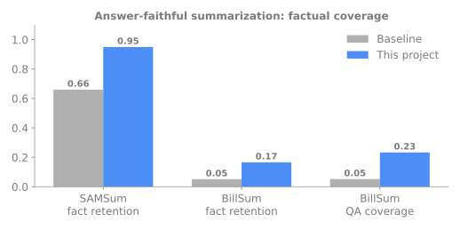

# Answer-Faithful Summarization

**Deep Learning project, Toronto Metropolitan University**

## The problem
Summaries are often the only thing people read. If a summary drops or invents a date, amount or ID, it causes real mistakes, and the usual summary score (ROUGE) does not catch it.

## What it does
A summarization model built to keep the key facts from the source, plus a way to measure whether those facts survive into the summary.

## Results

| Dataset | Metric | Baseline | This project |
|---|---|---|---|
| SAMSum (dialogues) | Fact retention | 0.66 | **0.95** |
| BillSum (legislation) | Fact retention | 0.051 | **0.166** |
| BillSum (legislation) | QA coverage | 0.052 | **0.233** |

Factual coverage rose sharply while ROUGE stayed about the same. Key finding: ROUGE alone is not enough to judge whether a summary is faithful.

## Skills shown
NLP, sequence-to-sequence models, hallucination reduction, factuality evaluation

## Tech
Python, TensorFlow

## Code availability
This is an overview page. The implementation, methods and experiment details are part of my private research and are not published here. I am happy to discuss the project in an interview.

## Contact
Deepu Sasi | deepusasi.ai@gmail.com | [LinkedIn](https://www.linkedin.com/in/deepu-sasi)
