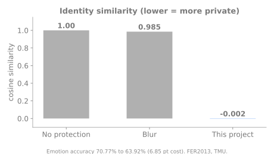

# Privacy-Preserving Facial Emotion Recognition

**Intelligent Systems project, Toronto Metropolitan University**

## The problem
Can a system read the emotion on a face without being able to tell *who* the person is? Common fixes like blurring barely hide identity.

## What it does
Transforms face images so emotion stays recognisable while identity is removed, with a setting that trades privacy against accuracy.

## Results (FER2013)

- Identity similarity, measured with a face-recognition model, dropped from **1.00 to -0.002**, compared with **0.985** for blurring.
- Emotion accuracy went from 70.77% to 63.92%, a **6.85 point** cost for near-total identity removal.

## Skills shown
Computer vision, deep learning, privacy-preserving ML, trade-off analysis

## Tech
Python, TensorFlow / Keras

## Code availability
This is an overview page. The implementation, methods and experiment details are part of my private research and are not published here. I am happy to discuss the project in an interview.

## Contact
Deepu Sasi | deepusasi.ai@gmail.com | [LinkedIn](https://www.linkedin.com/in/deepu-sasi)
