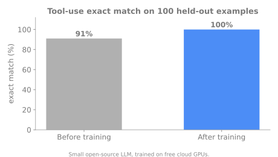

# SELF-FORGE: Teaching a Small LLM to Use Tools

**Personal research project (in progress)**

## The problem
Small language models are cheap to run but unreliable at calling tools: they pick the wrong tool, pass the wrong arguments, or call a tool when they should not.

## What SELF-FORGE does
Uses reinforcement learning with automatically checkable rewards to train a small open-source model to choose and call the right tool, and to recognise when no tool is needed. The whole thing runs on free cloud GPUs.

## Headline result

On **100 held-out examples, exact match went from 91% to 100%** after training, confirmed with a separate before-and-after evaluation.

## Next
A continual-learning study on how well the model keeps old skills as it learns new ones.

## Skills shown
Reinforcement learning for LLMs (RLVR / GRPO), parameter-efficient fine-tuning, reward design, evaluation, training on limited compute

## Tech
Python, PyTorch, HuggingFace ecosystem

## Code availability
This is an overview page. The implementation, methods and experiment details are part of my private research and are not published here. I am happy to discuss the project in an interview.

## Contact
Deepu Sasi | deepusasi.ai@gmail.com | [LinkedIn](https://www.linkedin.com/in/deepu-sasi)
